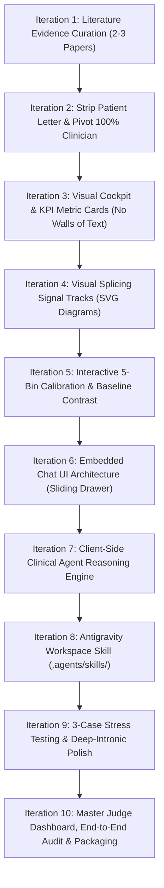

# 10-Iteration Master Plan: Clinical Decision Cockpit & AI Copilot

**Project:** AlphaGenome × SpliceVarDB BRCA1 Clinical Decision Support System  
**Persona:** Dr. Simi, Clinical Cancer Geneticist & Molecular Tumor Board Lead  
**Objective:** Evolve the initial integration into a publication-grade, interactive clinical cockpit with embedded Copilot chat, curated literature references, and zero walls of text across 10 disciplined end-to-end iterations.

---

## The 10-Iteration Development Loop

Each iteration follows a strict engineering cycle:
1. **Implement Feature/Refinement**
2. **Execute Pipeline End-to-End**
3. **Audit & Critique (Identify Flaws / Opportunities)**
4. **Advance to Next Iteration**

---

## Detailed Iteration Roadmap

### Iteration 1: Literature Evidence Curation & Data Schema
* **Goal:** Integrate 2–3 prioritized peer-reviewed literature citations for each clinical variant archetype.
* **Key Tasks:**
  - Curate top publications for canonical splice disruption, saturation mutagenesis, and deep-intronic cryptic splicing (e.g., *SpliceVarDB Consortium AJHG 2024*, *Findlay et al. Nature 2018*, *Avsec et al. Nature 2026*, *Steffensen et al.*).
  - Update `stage_case_data.py` to embed DOI, PubMed IDs, study type, and 1-sentence clinical takeaways into `data/staged_cases.json`.
* **Verification & Audit:** Confirm every case has 2–3 distinct, accurate, clickable citations.

---

### Iteration 2: Strip Patient Letter & Clinician-Centric Pivot
* **Goal:** Completely eliminate all patient-facing letter text and redirect 100% of focus to clinical geneticist & tumor board decision support.
* **Key Tasks:**
  - Remove patient letter drafting methods from `clinical_agent.py`.
  - Replace the dual-tab layout in `generate_clinical_report.py` with a clinical-only workflow:
    - **Panel A: Diagnostic Evidence & Signal Attribution**
    - **Panel B: Tumor Board Clinical Management & Surveillance Directives**
* **Verification & Audit:** Ensure zero patient-directed language remains; tone is 100% medical genetics.

---

### Iteration 3: Visual Cockpit & KPI Dashboard Redesign
* **Goal:** Eliminate dense paragraphs and replace them with high-contrast, scannable KPI cards that Dr. Simi can parse in <10 seconds.
* **Key Tasks:**
  - Design a top KPI hero row:
    - **Risk Badge:** Large visual status pill with color-coded severity.
    - **AlphaGenome Combined Score:** Prominent numeric callout.
    - **SpliceVarDB Status:** Verified laboratory ground truth pill.
    - **Calibration Placement:** Bin indicator with empirical PPV.
  - Convert narrative paragraphs into bulleted clinical highlights with bold lead-ins.
* **Verification & Audit:** Screen for any remaining "walls of text"; ensure visual hierarchy is immediate.

---

### Iteration 4: Visual Splicing Signal Tracks & Architecture Diagrams
* **Goal:** Make the biological mechanism visually intuitive through custom SVG signal diagrams.
* **Key Tasks:**
  - Build an SVG splice junction track visualizer for each case:
    - *Case 1:* Visual donor site consensus collapse (red signal drop from 0.996 to 0.000).
    - *Case 2:* Stable flat baseline (intact splicing).
    - *Case 3:* De novo cryptic pseudoexon activation 4,105 bp deep inside the intron.
* **Verification & Audit:** Confirm diagrams render cleanly without external image dependencies.

---

### Iteration 5: Interactive 5-Bin Calibration & Baseline Contrast
* **Goal:** Upgrade the calibration visualizer to emphasize statistical certainty and the contrast against distance heuristics.
* **Key Tasks:**
  - Add interactive hover tooltips for all 5 bins showing sample sizes ($n$), positive counts, and exact Wilson 95% CIs.
  - Feature an explicit callout card for intronic variants: **AlphaGenome (ROC AUC 0.993)** vs. **Baseline Distance Heuristic (ROC AUC 0.914)**, explaining why distance tools failed on deep intronic variants.
* **Verification & Audit:** Verify mathematical accuracy against `benchmark_reliability.csv`.

---

### Iteration 6: Embedded Chat UI Architecture (Sliding Drawer)
* **Goal:** Design and build the interactive chat drawer directly inside the HTML report.
* **Key Tasks:**
  - Build a persistent floating chat button (**"💬 Ask Dr. Simi's Copilot"**) in the bottom-right corner.
  - Implement a sliding side drawer with message history, user input field, send button, and quick-prompt suggestion chips.
  - Ensure zero external JS libraries (pure vanilla JavaScript and CSS).
* **Verification & Audit:** Test opening, closing, and responsiveness across desktop and mobile screen sizes.

---

### Iteration 7: Client-Side Clinical Agent Reasoning Engine
* **Goal:** Connect the chat interface to an interactive reasoning engine that answers user questions dynamically.
* **Key Tasks:**
  - Embed the variant's complete clinical knowledge base (scores, tracks, calibration, literature, ACMG criteria) into the client-side engine.
  - Implement intelligent question handling for common doctor queries:
    - *"Why is this classified as high risk?"*
    - *"What papers support this finding?"*
    - *"How does AlphaGenome compare to distance heuristics here?"*
    - *"What should I recommend to the tumor board?"*
    - Dynamic input handling for free-form clinical questions.
* **Verification & Audit:** Test all suggestion chips and free-form questions to ensure clinically sound, instant answers.

---

### Iteration 8: Antigravity Workspace Skill (`.agents/skills/`)
* **Goal:** Formally package the Dr. Simi Clinical Geneticist persona into an Antigravity Workspace Skill.
* **Key Tasks:**
  - Create `.agents/skills/dr-simi-copilot/SKILL.md` with YAML frontmatter (`name`, `description`).
  - Document the clinical methodology, literature retrieval rules, calibration lookup procedures, and guardrails.
  - Provide helper scripts in `.agents/skills/dr-simi-copilot/scripts/` linking directly to the python pipeline.
* **Verification & Audit:** Verify Antigravity discovers and registers the skill in the workspace.

---

### Iteration 9: 3-Case Multi-Scenario Stress Testing & Polish
* **Goal:** Execute the full pipeline across all three clinical archetypes and verify distinct clinical behavior.
* **Key Tasks:**
  - Re-run `run_clinical_pipeline.py` to regenerate `case1_pathogenic.html`, `case2_benign.html`, and `case3_deep_intronic.html`.
  - Verify that each case has custom literature citations, distinct SVG track diagrams, case-specific chat knowledge bases, and tailored clinical guidance.
* **Verification & Audit:** Confirm zero shared hardcoded strings between the 3 distinct clinical reports.

---

### Iteration 10: Master Showcase Dashboard, Final Audit & Packaging
* **Goal:** Polish the landing dashboard (`reports/index.html`) and assemble the final submission package.
* **Key Tasks:**
  - Rebuild `reports/index.html` to reflect the new visual cockpit styling, benchmark metrics (ROC AUC 0.980), and direct links to all three cases.
  - Run full static code and HTML5 validation.
  - Update `README.md` with complete architecture documentation, screenshot descriptions, and execution commands.
* **Verification & Audit:** Confirm any user can clone the repo, run `python run_clinical_pipeline.py`, and immediately open any report with full interactive chat functionality offline.

---

## Deliverables Summary

By Iteration 10, the repository will contain:
1. **Interactive HTML Reports with Embedded AI Copilot Chat:**
   - `reports/index.html` (Master Judge Showcase)
   - `reports/case1_pathogenic.html` (Canonical donor disruption)
   - `reports/case2_benign.html` (Benign exonic mimic)
   - `reports/case3_deep_intronic.html` (Deep-intronic cryptic splice)
2. **Prioritized Literature Citations (2–3 per variant)** with clickable PubMed/DOI links.
3. **Antigravity Workspace Skill:** `.agents/skills/dr-simi-copilot/SKILL.md`.
4. **Automated Pipeline Scripts:** `stage_case_data.py`, `clinical_agent.py`, `generate_clinical_report.py`, and `run_clinical_pipeline.py`.
