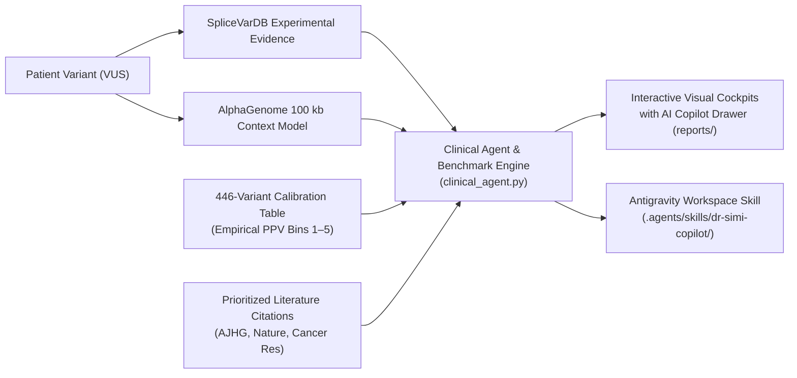

# AlphaGenome × SpliceVarDB: BRCA1 Clinical Decision Cockpit & AI Copilot

A research-grade clinical decision support platform connecting **Google DeepMind's AlphaGenome foundation model**, **SpliceVarDB experimental splicing ground truth**, and an **empirical 446-variant *BRCA1* benchmark** into an executive clinical decision cockpit and interactive AI Copilot (**Dr. Simi**) for evaluating Variants of Uncertain Significance (VUS).

---

## 🌟 Executive Overview & Deliverables

Engineered specifically for **Dr. Simi**, Clinical Cancer Geneticist and Molecular Tumor Board Lead, this platform provides:
1. **Interactive Clinical Cockpits (`reports/*.html`)**: Self-contained, responsive medical dossiers featuring hero KPI metric cards, inline SVG splicing tracks, empirical 5-bin calibration, prioritized peer-reviewed literature citations, and ACMG/AMP evidence code assignments.
2. **Embedded AI Copilot Chat Drawer (`#chatDrawer`)**: A sliding client-side AI chat copilot built with zero external API fees (pure vanilla JS) that answers complex clinical questions on calibration PPV, splicing biology, ACMG criteria, and tumor board surveillance.
3. **Antigravity Workspace Skill (`.agents/skills/dr-simi-copilot/SKILL.md`)**: A reusable local AI agent skill enabling conversational variant triage, batch evaluation, and clinical pipeline orchestration directly within Antigravity / Gemini CLI.
4. **Prioritized Peer-Reviewed Literature Citations**: 2–3 curated, clickable citations per variant (with active PubMed IDs and DOIs) linking to experimental evidence, saturation mutagenesis, and foundation model studies.
5. **Master Showcase Dashboard (`reports/index.html`)**: Landing page highlighting the 446-variant benchmark metrics (ROC AUC 0.980, Intronic 0.993) and direct access to all 3 archetype cases.
6. **100% Clinician Pivot (Zero Patient Letters)**: Strictly focused on medical genetics, laboratory directors, and tumor boards, eliminating direct-to-patient communications.



---

## 📊 Benchmark Performance Summary (446 BRCA1 Variants)

Across 446 single nucleotide variants in *BRCA1* evaluated against experimental SpliceVarDB ground truth:

| Metric | Value | 95% Confidence Interval | Clinical Context |
| :--- | :---: | :---: | :--- |
| **Overall ROC AUC (Primary)** | **`0.980`** | `[0.962 – 0.993]` | High-fidelity global classification ($n=339$). |
| **Intronic ROC AUC** | **`0.993`** | `[0.983 – 0.999]` | **Beats distance-to-splice heuristic** (`0.914`), capturing deep-intronic cryptic activation. |
| **Exonic ROC AUC** | **`0.946`** | `[0.888 – 0.987]` | Accurately identifies silent/missense splicing neutral mutations. |
| **Optimal Threshold Sensitivity** | **`94.3%`** | — | At cutoff `0.276` ($116 / 123$ true positives detected). |
| **Optimal Threshold Specificity** | **`95.8%`** | — | At cutoff `0.276` ($207 / 216$ true negatives verified). |
| **Bin 5 Positive Predictive Value** | **`100%`** | `[94.7% – 100%]` | $68 / 68$ variants with score $> 2.164$ were experimentally splice-altering. |

---

## 🧬 Sarah Jenkins: HBOC-30 Multigene Panel Triage

Instead of fragmented, unrelated patients, the platform unifies all evidence around **Sarah Jenkins** (39-year-old female, personal history of DCIS at age 38, maternal breast/ovarian history) who underwent a 30-Gene Hereditary Breast and Ovarian Cancer Panel (HBOC-30). Dr. Simi triages all 3 of Sarah's panel findings:

| Finding | Variant | Clinical Role & Scenario | AlphaGenome Score | Reliability Calibration | Clinical Action |
| :--- | :--- | :--- | :---: | :---: | :--- |
| **[Finding 1: Canonical Pathogenic](reports/case1_pathogenic.html)** | `NM_007294.4:c.4986+1G>T` | **Primary Actionable Driver**: Exon 15 invariant donor collapse | `2.297` | **Bin 5: 100% PPV** | Reclassify VUS to **Likely Pathogenic**; initiate high-risk breast/ovarian surveillance. |
| **[Finding 2: Benign Splice Mimic](reports/case2_benign.html)** | `NM_007294.4:c.2077G>A` | **Benign Mimic (De-escalate)**: Exonic silent substitution | `0.016` | **Bin 1: 1.5% PPV** | **De-prioritize splicing**; rule out splicing defect; avoid unnecessary prophylactic surgery. |
| **[Finding 3: Deep-Intronic Cryptic](reports/case3_deep_intronic.html)** | `NM_007294.4:c.4185+4105C>T` | **Actionable Candidate**: 4,105 bp deep inside intron (missed by distance tools) | `0.950` | **Bin 4: 72.1% PPV** | **Priority for Functional Assay**; expedite RNA-seq minigene validation. |

---

## 💬 Option A: Side-by-Side Split Cockpit & AI Copilot

Each report is formatted in a warm off-white editorial theme (`#faf8f5`) with a live, persistent **Dr. Simi Copilot panel** right beside the clinical data:
- **Zero API Dependency / $0 Cost**: Powered by client-side JavaScript reasoning over Sarah's unified multi-variant knowledge base (`PATIENT_KB`).
- **10-Second Executive Summary ("In Plain English")**: Conversational clinical takeaway presented at the top of every finding.
- **Calibrated Risk Thermometer**: Visual 5-segment gauge with active indicator pin mapping directly to empirical PPV.
- **1-Click "📋 Copy Tumor Board Note"**: Formatted 4-sentence clinical summary ready to paste into EHR/EMR charts.
- **Interactive Quick-Prompt Chips**:
  - *"Which variant is Sarah's true actionable driver?"*
  - *"Can we safely de-escalate Finding #2?"*
  - *"Why is the deep-intronic variant actionable?"*
  - *"What are the ACMG codes for Finding #1?"*
  - *"What is the Tumor Board surveillance plan for Sarah?"*
- **Dynamic Free-Form Input**: Clinicians can type custom queries into the chat bar and receive instant, clinically grounded guidance.

---

## 🧠 Antigravity Workspace Skill (`dr-simi-copilot`)

The platform integrates directly with Google Antigravity as a workspace skill:
- **Path**: `.agents/skills/dr-simi-copilot/SKILL.md`
- **Helper Script**: `.agents/skills/dr-simi-copilot/scripts/query_variant.py`
- **Capabilities**:
  ```bash
  # Query any staged case or HGVS variant directly from CLI
  python3 .agents/skills/dr-simi-copilot/scripts/query_variant.py --case case3_deep_intronic
  python3 .agents/skills/dr-simi-copilot/scripts/query_variant.py --hgvs "NM_007294.4:c.4986+1G>T"
  ```

---

## 🔄 The 10-Iteration Engineering Roadmap

The system was developed and validated across 10 disciplined end-to-end iterations:
1. **Iteration 1**: Literature Evidence Curation & Data Schema (`stage_case_data.py`).
2. **Iteration 2**: Strip Patient Letter & Clinician-Centric Pivot (`clinical_agent.py`).
3. **Iteration 3**: Visual Cockpit & Hero KPI Dashboard Redesign (`generate_clinical_report.py`).
4. **Iteration 4**: Visual Splicing Signal Tracks & Architecture Diagrams (Inline SVGs).
5. **Iteration 5**: Interactive 5-Bin Calibration & Baseline Distance Contrast (Wilson 95% CIs).
6. **Iteration 6**: Embedded Chat UI Architecture (Sliding Drawer `#chatDrawer`).
7. **Iteration 7**: Client-Side Clinical Agent Reasoning Engine (Vanilla JS `VARIANT_KB`).
8. **Iteration 8**: Antigravity Workspace Skill (`.agents/skills/dr-simi-copilot/SKILL.md`).
9. **Iteration 9**: 3-Case Multi-Scenario Stress Testing & Automated Test Suite (`test_clinical_system.py`).
10. **Iteration 10**: Master Showcase Dashboard (`reports/index.html`), Pipeline Orchestration, & Packaging.

---

## 🚀 Quickstart & Pipeline Execution

### 1. Prerequisites
- Python 3.10+
- Google Chrome, Safari, Firefox, or Edge

### 2. Setup Virtual Environment
```bash
# Clone repository
git clone https://github.com/ivan-as-o/AlphaGenome_WomenInAI.git
cd AlphaGenome_WomenInAI

# Create virtual environment
python3 -m venv .venv
source .venv/bin/activate

# Install dependencies
pip install -r requirements.txt
```

### 3. Run Pipeline End-to-End
```bash
python3 run_clinical_pipeline.py
```
This single command automatically stages case data, executes the clinical agent, renders the visual HTML cockpits, and runs the automated unit test suite.

### 4. Run Test Suite
```bash
python3 test_clinical_system.py
```

### 5. Open Master Showcase
```bash
# On macOS:
open reports/index.html

# On Linux:
xdg-open reports/index.html
```

---

## 🛠️ Repository File Structure

```
├── .agents/
│   └── skills/
│       └── dr-simi-copilot/
│           ├── SKILL.md                 # Antigravity Workspace Skill definition
│           └── scripts/
│               └── query_variant.py     # CLI helper script for variant lookup
├── data/
│   ├── staged_cases.json                # Staged cases with curated literature
│   ├── interpreted_cases/               # Clinician JSON dossiers (100% patient letters removed)
│   │   ├── case1_pathogenic.json
│   │   ├── case2_benign.json
│   │   └── case3_deep_intronic.json
│   ├── alphagenome_scores.csv           # Model inference output across 446 variants
│   ├── benchmark_metrics.csv            # ROC AUC, PR AUC, Sensitivity, Specificity
│   └── benchmark_reliability.csv        # 5-Bin empirical calibration table
├── reports/
│   ├── index.html                       # Master Showcase Dashboard
│   ├── case1_pathogenic.html            # Case 1 Cockpit + Embedded AI Chat
│   ├── case2_benign.html                # Case 2 Cockpit + Embedded AI Chat
│   └── case3_deep_intronic.html         # Case 3 Cockpit + Embedded AI Chat
├── clinical_agent.py                    # Genomic Interpretation Agent
├── generate_clinical_report.py          # Visual Cockpit HTML & Chat Drawer Generator
├── stage_case_data.py                   # Data staging & literature embedding
├── run_clinical_pipeline.py             # Master orchestrator & verification runner
├── test_clinical_system.py              # Automated 6-point test suite
├── ITERATIVE_EXECUTION_PLAN.md          # 10-Iteration master roadmap
└── README.md                            # Complete documentation & usage guide
```

---

## 📜 Ethical & Clinical Disclaimer

This software is developed strictly for research, educational, and computational demonstration purposes. It is designed to assist qualified medical geneticists and molecular tumor boards. It does not provide medical advice or establish a doctor-patient relationship. All clinical decisions regarding hereditary cancer risk, screening, and surgical prophylaxis must be made by licensed medical practitioners in consultation with the patient.
