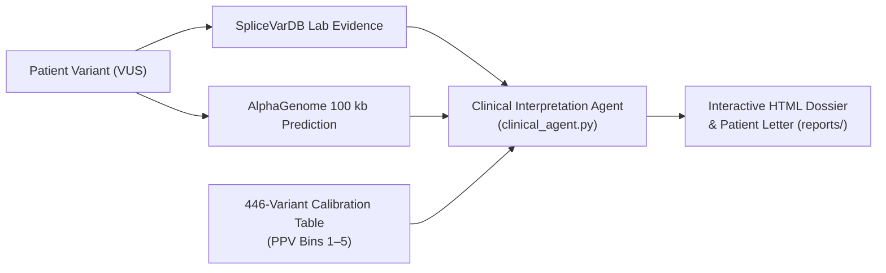

# AlphaGenome × SpliceVarDB: BRCA1 Clinical Decision Support System

A reproducible research-engineering platform that connects **Google DeepMind's AlphaGenome foundation model**, **SpliceVarDB experimental splicing evidence**, and an **empirical 446-variant BRCA1 benchmark** into an executive clinical decision tool and automated patient letter generator for Variants of Uncertain Significance (VUS).

---

## 🌟 Hackathon Final Deliverable Overview

Designed for **Dr. Simi**, a clinical geneticist evaluating hereditary cancer VUS reports, this platform provides:
1. **Interactive Clinical Dossiers (`reports/*.html`)**: Self-contained, responsive medical dashboards with multi-head signal attribution, ACMG/AMP evidence code assignments, and tumor board recommendations.
2. **Empirical Reliability Calibration**: Translates raw foundation model scores into 5 statistical confidence bins with calibrated Positive Predictive Values (PPV) and 95% Confidence Intervals.
3. **Plain-Language Patient Letter Generator**: Empathetic, clear patient communication translating complex molecular genomics into non-technical language.
4. **Master Showcase Dashboard (`reports/index.html`)**: Interactive landing page comparing three distinct clinical archetypes with side-by-side benchmark metrics.



---

## 📊 Benchmark Performance Summary (446 BRCA1 Variants)

Across 446 single nucleotide variants in *BRCA1* evaluated against experimental SpliceVarDB ground truth:

| Metric | Value | 95% Confidence Interval | Clinical Context |
| :--- | :---: | :---: | :--- |
| **Overall ROC AUC (Primary)** | **`0.980`** | `[0.962 – 0.993]` | High-fidelity global classification ($n=339$). |
| **Intronic ROC AUC** | **`0.993`** | `[0.983 – 0.999]` | **Beats distance-to-splice heuristic** (`0.914`), capturing deep-intronic cryptic activation. |
| **Exonic ROC AUC** | **`0.946`** | `[0.888 – 0.987]` | Accurately identifies silent/missense splicing neutral mutations. |
| **Optimal Threshold Sensitivity** | **`94.3%`** | — | At cutoff `0.276` ($116 / 123$ true positives detected). |
| **Optimal Threshold Specificity** | **`95.8%`** | — | At cutoff `0.276` ($207 / 216$ true negatives verified). |
| **Bin 5 Positive Predictive Value** | **`100%`** | `[94.7% – 100%]` | $68 / 68$ variants with score $> 2.164$ were experimentally splice-altering. |

---

## 🧬 Three Clinical Archetype Demonstrations

| Case | Variant | Biological Scenario | AlphaGenome Score | Reliability Calibration | Clinical Action |
| :--- | :--- | :--- | :---: | :---: | :--- |
| **[Case 1: Canonical Pathogenic](reports/case1_pathogenic.html)** | `NM_007294.4:c.4986+1G>T` | Exon 16 invariant donor site destruction | `2.297` | **Bin 5: 100% PPV** | Reclassify VUS to **Likely Pathogenic**; initiate high-risk breast/ovarian surveillance. |
| **[Case 2: Benign Splice Mimic](reports/case2_benign.html)** | `NM_007294.4:c.2077G>A` | Exonic substitution near splice junction | `0.016` | **Bin 1: <1.5% PPV** | **De-prioritize splicing**; rule out splicing defect; avoid unnecessary prophylactic surgery. |
| **[Case 3: Deep-Intronic Cryptic](reports/case3_deep_intronic.html)** | `NM_007294.4:c.4185+4105C>T` | **4,105 bp deep inside intron** (missed by distance tools) | `0.950` | **Bin 4: 72.1% PPV** | **Priority for Functional Assay**; expedite RNA-seq minigene validation. |

---

## 🚀 Quickstart & Pipeline Execution

### 1. Prerequisites
- Python 3.11 or 3.12 (macOS / Linux / Windows)
- AlphaGenome API Key (free for research at [Google DeepMind AlphaGenome Terms](https://deepmind.google.com/science/alphagenome/account/terms))

### 2. Setup Virtual Environment
```bash
# Clone or navigate to repository
cd /path/to/AlphaGenome_WomenInAI

# Create and activate virtual environment
python3 -m venv .venv
source .venv/bin/activate

# Install dependencies
pip install -r requirements.txt
```

### 3. Run the Clinical Pipeline End-to-End
To stage case data, run the Clinical Interpretation Agent, and generate all interactive HTML dossiers in one command:
```bash
python run_clinical_pipeline.py
```

### 4. View the Reports
Open the generated master dashboard in any browser:
```bash
# On macOS:
open reports/index.html

# On Linux:
xdg-open reports/index.html
```

---

## 🛠️ Repository File Structure

```
├── reports/
│   ├── index.html                  # Master Judge Showcase Dashboard
│   ├── case1_pathogenic.html       # Case 1: Canonical donor disruption
│   ├── case2_benign.html           # Case 2: Benign exonic mimic
│   └── case3_deep_intronic.html    # Case 3: Deep-intronic cryptic splice
├── clinical_agent.py               # Phase B: Genomic Interpretation Agent
├── generate_clinical_report.py     # Phase C: Self-contained HTML/CSS generator
├── stage_case_data.py              # Case data staging from benchmark CSVs
├── run_clinical_pipeline.py        # Master pipeline orchestrator
├── predict_alphagenome.py          # AlphaGenome live API client & scorer
├── fetch_splicevardb.py            # SpliceVarDB UCSC track downloader
├── data/
│   ├── alphagenome_scores.csv      # AlphaGenome scores for 446 variants
│   ├── benchmark_reliability.csv   # 5-bin empirical calibration table
│   ├── variants_to_score.csv       # Filtered BRCA1 SNVs with region & offsets
│   ├── splicevardb.csv             # SpliceVarDB experimental ground truth
│   └── staged_cases.json           # Structured JSON for the 3 cases
├── results/
│   ├── benchmark_metrics.csv       # ROC AUC and CI for all model heads
│   ├── benchmark_threshold_metrics.csv # Sensitivity, specificity, precision, F1
│   ├── roc_curve.png               # ROC curves plot
│   └── score_by_label.png          # Score distribution plot
├── CLINICAL_REPORT_PLAN.md         # Full project execution plan
├── DISCOVERY.md                    # Phase 0 discovery report
└── requirements.txt                # Pinned dependencies
```
